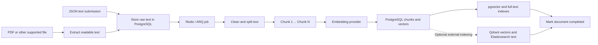
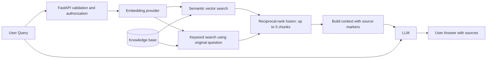

# 🗺️ System Architecture Overview

This repository implements **Retrieval-Augmented Generation (RAG)** with FastAPI. It prepares documents for search, finds passages relevant to a question, and gives those passages to a language model so it can produce an answer with source references.

The supplied architectural images describe two connected workflows:

- **Ingestion — prepare the knowledge base:** documents → extracted text → chunks → embeddings → semantic index.
- **Retrieval and generation — answer a question:** user query → query embedding → search → ranked chunks → LLM → user answer.

> **📌 Reading this guide:** The diagrams below redraw the supplied images using the actual repository components. File links and method names describe the current implementation. Examples explicitly labeled *illustrative* are explanations, not captured runtime results.

## 🖼️ Figure 1 — Building the knowledge base



**Mapping to the first image:** “Extract Data” is `extract_file()`, “Split into chunks” is `chunk_text()`, “Embedding API” is the selected embedding provider, and “Build semantic index” is PostgreSQL indexing plus optional external synchronization. The queue and completion status make the diagram's preparation work asynchronous.

Uploaded files are parsed in the API process using a worker thread. The ARQ worker then cleans, chunks, embeds, and indexes the extracted text. JSON text submissions skip file extraction. The database stores extracted text; this implementation does not archive the original uploaded binary.

## 🖼️ Figure 2 — From User Query to User Answer



**Mapping to the second image:** the six stages remain query → embedding → semantic search → ranked results → LLM → answer. This repository adds a **keyword search branch** and merges the two rankings. In code, both searches start concurrently after query embedding finishes.

For Markdown viewers without Mermaid support:

```text
User Query
    |
    v
POST /api/query -> validate, authorize, rate-limit
    |
    v
Embedding provider -> numerical query vector
    |
    +--> Vector search ---------+
    |                           |   PostgreSQL is authoritative
    +--> Keyword search --------+   for chunk text and document status
         (original question)    |
                                v
                    Merge rankings -> top 5 maximum
                                |
                                v
                    Context text + [source:n] markers
                                |
                    Original question + context
                                |
                                v
                              LLM
                                |
                                v
                  User Answer + sources + debug data
```

> **💡 Mental model:** Ingestion organizes a library. Retrieval selects useful pages. The LLM reads those selected pages and writes a response. The model does not search the database itself.

# 📦 Database & Storage (Knowledge Base)

## What is stored?

The image highlights two essential items:

1. **Embeddings:** numerical vectors used to compare a question with document passages.
2. **Doc chunks:** the readable passages that become the LLM's context.

In this repository, both live in PostgreSQL. See the [schema migration](migrations/001_initial.sql) and [repository operations](app/db/repository.py).

| Storage | Contents | Purpose |
| --- | --- | --- |
| `documents` | ID, filename, MIME type, source, raw text, status, timestamps | Track each input and its processing lifecycle |
| `document_chunks.content` | Readable chunk text | Supply evidence to the LLM |
| `document_chunks.embedding` | `vector(__DIMENSIONS__)`, resolved during migration | Compare semantic similarity |
| Other chunk fields | Chunk ID, document ID, chunk index, token count, metadata, timestamp | Preserve identity, order, and source traceability; metadata defaults to `{}` |
| `document_chunks.search_vector` | Generated English `tsvector` | Support PostgreSQL keyword retrieval |
| Redis | ARQ jobs and rate-limit counters | Coordinate processing and HTTP throttling |

The migration creates an **HNSW cosine index** for embeddings and a **GIN index** for full-text search. These indexes update through database writes; the default backend does not require a separate application-level index-building job.

## Diagram engine names versus implemented backends

The supplied images list **ChromaDB, Faiss** (also written as “Fiass” in the request), **Pinecone, and Azure Index** as possible knowledge-base choices. Those labels are architectural alternatives, not a list of adapters implemented here.

| Engine or stack | Repository support | Role here |
| --- | --- | --- |
| PostgreSQL + pgvector | **Implemented; default** | Authoritative document, chunk, and embedding storage; vector and keyword search |
| Qdrant + Elasticsearch | **Implemented; optional pair** | External vector and keyword indexes, backed by PostgreSQL |
| ChromaDB | No adapter implemented | Diagram alternative |
| Faiss / Fiass | No adapter implemented | Diagram alternative |
| Pinecone | No adapter implemented | Diagram alternative |
| Azure Index | No adapter implemented | Diagram alternative |

[`Settings.search_backend`](app/core/config.py) accepts only `postgres` or `qdrant-elasticsearch`.

In external mode, [`SearchService.sync_document()`](app/services/search.py) copies vectors and document IDs into Qdrant, and chunk text and document IDs into Elasticsearch. Search hits return chunk IDs; `Repository.hydrate()` loads their current text from PostgreSQL and filters out documents that are not completed. PostgreSQL remains required in both modes.

> **🔧 Embedding compatibility:** Ingestion and query embedding must use the same model and dimensions. The default dimension is 1,536. Changing models requires regenerating stored embeddings; changing dimensions also requires a compatible database schema and external collection. [`app.reindex`](app/reindex.py) copies existing embeddings into external indexes—it does not regenerate them.

## Ingestion lifecycle and recovery

The first image's preparation flow maps to these operations:

1. **Accept text or upload:** `POST /api/documents` or `POST /api/documents/upload` calls `DocumentsService`.
2. **Extract text:** uploads support PDF, DOCX, XLSX, CSV, TXT, Markdown, JSON, and HTML. Scanned PDFs need OCR outside this pipeline.
3. **Persist before queuing:** `Repository.create()` stores raw text with status `queued`; `DocumentsService.create()` enqueues `process_document`.
4. **Clean and split:** the worker calls `clean_text()` and `chunk_text()`. `SentenceSplitter` uses a 200-token chunk target and 30-token overlap by default. Chunking splits text; it does not summarize or compress it.
5. **Embed and save:** each chunk receives an embedding. `replace_chunks()` replaces the document's chunks inside a PostgreSQL transaction.
6. **Synchronize and complete:** optional external indexing finishes before the worker sets status to `completed`.

```text
queued -> processing -> completed
                |
                v
              failed -> processing (when a retry runs)
```

[`process_document()`](app/workers/ingestion.py) uses a PostgreSQL advisory lock to serialize work on the same document, skips completed documents, and retries ordinary failures up to three attempts. If initial enqueueing fails, the durable queued row remains available to `dispatch_queued()`, which runs at worker startup and at seconds 0 and 30 of each minute.

> **📌 Visibility boundary:** Queries retrieve only completed documents. PostgreSQL chunk replacement is transactional, but PostgreSQL, Qdrant, and Elasticsearch do not share one distributed transaction. Retry and reindex behavior therefore matter when external indexing fails. The periodic dispatcher scans `queued` rows; it is not a general recovery sweep for every failed or stranded processing row.

# 🔄 Step-by-Step Execution Pipeline

## Step 1: User Query Submission — the entry point

> **💡 Human picture:** A reader asks the librarian a question. The front desk checks the request before searching.

The client sends:

```http
POST /api/query
Content-Type: application/json
x-api-key: <configured-api-key>

{"question":"How long do I have to request a refund?"}
```

[`query()`](app/api/routes/query.py) receives a [`QueryInput`](app/schemas/query.py), obtains the shared `QueryService` through dependency injection, and calls `service.query(body.question)`.

- The question length must be between **1 and 2,000 characters**.
- [`authorize()`](app/api/dependencies.py) checks `x-api-key` when `API_KEY` is configured and uses Redis for request throttling.
- Validation failures return **400**, invalid keys return **401**, and rate-limit failures return **429**.
- The request currently accepts `question`; it does **not** expose a `topK` parameter.

**Output:** a validated question string passed to `QueryService.query()`.

## Step 2: Embedding API — convert the question to a vector

> **💡 Human picture:** The question receives a numerical address so it can be compared with the addresses of stored passages.

[`QueryService.query()`](app/services/retrieval.py) first awaits `self.embeddings.embed(question)`. [`open_resources()`](app/resources.py) chooses the provider from configuration:

| Provider | Behavior |
| --- | --- |
| `fake` | Creates a deterministic vector locally for development and tests; it does not provide meaningful semantic understanding |
| `openai-compatible` | Sends the model, input text, and dimensions to the configured provider's `/embeddings` endpoint |

[`validate_vector()`](app/integrations/providers.py) checks remote vectors for the expected length and finite numeric values. The same configured embedding implementation is used by document ingestion.

**Output:** `list[float]` representing the question. A schematic vector such as `[0.12, -0.08, ...]` illustrates the shape, not an actual result.

## Step 3: Semantic Search — compare against the knowledge base

> **💡 Human picture:** The librarian looks for passages about the same idea and also checks the words the reader used.

The service concurrently calls:

```python
vector, keyword = await asyncio.gather(
    self.search.vector_search(embedding),
    self.search.keyword_search(question),
)
```

[`SearchService`](app/services/search.py) selects the configured backend:

| Search branch | PostgreSQL mode | External mode |
| --- | --- | --- |
| Semantic/vector | pgvector cosine distance through `<=>`; smaller distance ranks first | Qdrant cosine search, then PostgreSQL hydration |
| Keyword | English full-text matching with `websearch_to_tsquery` and `ts_rank_cd` | Elasticsearch text `match`, then PostgreSQL hydration |

Both branches return **up to 10 chunks** by default. External queries request up to 30 candidates per branch before filtering and retaining up to 10 current, completed-document hits. PostgreSQL keyword ranking here is full-text ranking, not a custom BM25 implementation.

**Output:** two ranked lists containing document IDs, filenames, chunk indexes, readable content, and branch-specific scores.

> **📌 Score meaning:** Vector distance and keyword rank are different measurements. Neither is a probability that an answer is correct. The next step combines positions in the result lists rather than adding incompatible raw scores.

## Step 4: Top-K Ranked Results — select and build context

> **💡 Human picture:** The librarian merges two shortlists, removes repeated passages, and hands the best few to the writer.

[`merge_hybrid_results()`](app/services/retrieval.py) uses **reciprocal-rank fusion (RRF)**:

```text
Contribution from each branch = 1 / (60 + rank)
rank starts at 1
A chunk found in both branches receives both contributions.
```

Chunks are deduplicated by `(documentId, chunkIndex)`, sorted by descending `hybridScore`, and limited to **five** by default. There is no separate learned reranker in this flow.

The image's **top-K** means “how many ranked passages to keep.” Current limits are code defaults:

| Stage | Current limit | Code location |
| --- | --- | --- |
| Vector candidate list | 10 | `SearchService.vector_search(limit=10)` |
| Keyword candidate list | 10 | `SearchService.keyword_search(limit=10)` |
| Fused results | 5 | `merge_hybrid_results(limit=5)` |
| Context assembly | 3,000-character target | `build_context(max_characters=3000)` |

`build_context()` adds markers such as `[source:1]` before chunk text and creates source metadata with the document ID, filename, chunk index, and a short snippet. The full included chunk text goes to the model; snippets are response metadata.

**Fewer than K passages may reach the LLM.** There may be fewer results, or context assembly may stop before the next chunk fits. The first result is always included even if it exceeds the character target, and separator characters are not counted. This is therefore a **soft character budget**, not a strict token limit.

**Output:** `BuiltContext(text=..., sources=...)`. Source numbers follow context order and can change between requests.

## Step 5: LLM — combine the original question and retrieved context

> **💡 Human picture:** A writer receives the question and the selected pages, then drafts an answer using those pages.

The service calls `self.llm.generate(question, context.text)`. For the remote provider, [`OpenAICompatibleProvider.generate()`](app/integrations/providers.py) sends a `/chat/completions` request with:

- The configured LLM model and temperature `0.2`.
- A system instruction to answer only from context, acknowledge insufficient information, cite `[source:n]` markers, and treat retrieved text as data.
- A user message containing the **original question and readable retrieved context**.

The LLM receives text, not the embedding vectors. Retrieval supplies evidence; generation turns it into a natural-language response.

> **📌 Grounding boundary:** The prompt requests grounded answers and citations. The code validates that the generated answer is nonempty, but it does not independently verify factual accuracy or citation correctness. Empty retrieval still reaches the LLM with an explicit no-context message.

The default `FakeLlmProvider` returns a fixed draft-answer template when context exists, or an insufficient-context message otherwise. It does not synthesize a factual answer from the passages.

## Step 6: User Answer Generation — return the result

> **💡 Human picture:** The reader receives an answer together with references to the pages used.

[`QueryService.query()`](app/services/retrieval.py) constructs a [`QueryResponse`](app/schemas/query.py). The route returns **HTTP 201** with:

| Field | Meaning |
| --- | --- |
| `question` | Original question |
| `answer` | Generated answer text |
| `sources` | Metadata for chunks actually included in context |
| `debug.results` | Fused result list, including retrieval provenance and scores |
| `debug.context` | Context text and its source metadata |

The response is ordinary JSON; this route does not stream tokens. `sources` identifies available context evidence, not proof that every listed source was cited by the LLM. Debug results can include chunks excluded from the final context by its size budget.

# 🧑‍💻 Codebase Mapping Guide

These are actual repository paths in place of the requested placeholders.

| Visual block or responsibility | Code file | Main symbols / behavior |
| --- | --- | --- |
| Application entry point | [app/main.py](app/main.py) | `create_app()`, lifespan, `/api` route registration |
| Dependency construction | [app/resources.py](app/resources.py) | `open_resources()`: database, Redis, HTTP clients, providers, services |
| Request authorization | [app/api/dependencies.py](app/api/dependencies.py) | `authorize()`, `get_query()`, `get_documents()` |
| Document entry points | [app/api/routes/documents.py](app/api/routes/documents.py) | Text creation, file upload, document status routes |
| Ingestion submission | [app/services/documents.py](app/services/documents.py) | `DocumentsService.upload()` and `create()` |
| **Ingestion logic** | [app/services/ingestion.py](app/services/ingestion.py) | `extract_file()`, `clean_text()`, `chunk_text()` |
| Background ingestion | [app/workers/ingestion.py](app/workers/ingestion.py) | `process_document()`, `dispatch_queued()`, `WorkerSettings` |
| Embedding API and LLM adapters | [app/integrations/providers.py](app/integrations/providers.py) | Provider protocols, fake providers, `OpenAICompatibleProvider` |
| Knowledge-base schema | [migrations/001_initial.sql](migrations/001_initial.sql) | Documents, chunks, vectors, HNSW and GIN indexes |
| **Vector queries and persistence** | [app/db/repository.py](app/db/repository.py) | `vector_search()`, `keyword_search()`, `hydrate()`, `replace_chunks()` |
| Backend selection and external indexes | [app/services/search.py](app/services/search.py) | `SearchService`, `ensure_indexes()`, `sync_document()` |
| User query entry point | [app/api/routes/query.py](app/api/routes/query.py) | `query()` |
| Ranked results and context | [app/services/retrieval.py](app/services/retrieval.py) | `merge_hybrid_results()`, `build_context()` |
| **LLM orchestration** | [app/services/retrieval.py](app/services/retrieval.py) | `QueryService.query()` runs embed → retrieve → generate |
| Input/output contracts | [app/schemas/query.py](app/schemas/query.py) | `QueryInput`, `QueryResponse`, `ContextSource`, `QueryDebug` |
| Runtime configuration | [app/core/config.py](app/core/config.py) | `Settings`, backend/provider selection and production validation |
| Schema and index maintenance | [app/migrate.py](app/migrate.py), [app/reindex.py](app/reindex.py) | Database migration and external index rebuild |

**Read the request flow in this order:** route → dependency injection → service → search/provider → repository. `self.repository` is injected by `open_resources()`; it is an instance of this project's `Repository`, not a built-in FastAPI object.

## Operational behavior behind the diagram

| Concern | Implemented behavior and practical limit |
| --- | --- |
| Process boundaries | API and ARQ worker are separate processes. Each opens and closes its own shared resource pool through `open_resources()` |
| Startup | Run migrations before serving traffic; keep the worker running for ingestion. Setup commands are in [README.md](README.md) |
| Production configuration | `NODE_ENV=production` rejects fake providers, API/metrics keys shorter than 32 characters, and wildcard CORS origins |
| Failure responses | [Exception handlers](app/core/exceptions.py) return structured errors; unexpected failures return a generic 500. Query orchestration has no application-level retry or alternate-backend fallback |
| Readiness | [`/api/health/ready`](app/api/routes/health.py) checks PostgreSQL, Redis, and enabled search services; it does not prove provider availability or document-processing progress |
| Observability | [Middleware](app/core/middleware.py) provides request IDs, HTTP metrics, and logs; [telemetry](app/core/telemetry.py) instruments RAG stages with optional OpenTelemetry spans |
| Data exposure | Query responses include full debug context. Shared API-key authorization does not implement per-user or per-tenant document filtering |
| Model quality | Fake providers test plumbing. Real retrieval relevance, grounded answers, and citation accuracy need evaluation with representative documents and questions |

Existing verification coverage lives in [pipeline tests](tests/test_pipeline.py), [API tests](tests/test_api.py), [worker tests](tests/test_worker.py), and [integration tests](tests/test_integration.py). Live integration checks require the configured database, Redis, and any selected external search services. This document describes source behavior, not a certification of a running deployment.

# 📝 Human-Style Walkthrough Example

## Scenario: “Can I get a refund after 20 days?”

**Illustrative setup:** an organization has ingested its refund policy. The worker has finished, and the document status is `completed`. Suppose retrieval selects these three passages from a longer policy; this is an assumed result, not a claim that the short text below produces three chunks under the default splitter.

| Selected passage | Text |
| --- | --- |
| Chunk A | “Customers may request refunds within 30 days of purchase.” |
| Chunk B | “Refund requests must include the order number and proof of purchase.” |
| Chunk C | “Approved refunds are returned to the original payment method.” |

### 1. The user asks

“**I bought something 20 days ago. Can I request a refund, and what do I need?**”

The client submits that question to `/api/query`. FastAPI validates it and the authorization dependency checks access and throttling.

### 2. The system creates the question embedding

With a real embedding provider configured, the question becomes a numerical vector that can be compared with stored policy vectors. The original question is also retained for keyword search and generation.

### 3. The system searches in two ways

Semantic search looks for passages with related meaning. Keyword search looks for matching terms such as “refund.” Both return ranked candidates from completed documents.

Imagine Chunk A ranks first in both branches. Its fused score is:

```text
1 / (60 + 1) + 1 / (60 + 1) ≈ 0.03279
```

This is a ranking score, not a 3.279% confidence estimate.

### 4. Three passages become the context

The fusion limit is five, but suppose the merged candidate set contains only these three chunks. All three fit the context budget, so the context builder produces:

```text
[source:1] Customers may request refunds within 30 days of purchase.

[source:2] Refund requests must include the order number and proof of purchase.

[source:3] Approved refunds are returned to the original payment method.
```

The context travels with the question to the LLM. The application also retains each source's document ID, filename, and chunk index for the response.

### 5. The LLM writes a grounded answer

With a real LLM provider, an **illustrative answer** is:

> Yes. At 20 days after purchase, you are within the 30-day period for requesting a refund. [source:1] Include your order number and proof of purchase. [source:2] If approved, the refund will go to your original payment method. [source:3]

The answer distinguishes eligibility to **request** a refund from guaranteed approval because the supplied passages do not guarantee approval.

### 6. The user receives the answer and references

The API returns the answer, three source records, and debug information. A client can display the text and associate each `[source:n]` marker with its source record. The repository supplies the API response; a citation-rendering user interface is a separate client responsibility.

> **🧪 Trying this with defaults:** The fake LLM will return `Based on the retrieved context, here is a draft answer to: "<question>".` when context is present. The factual answer above requires a real model and is not guaranteed wording. If no context is retrieved, the fake provider returns `I don't have enough retrieved context to answer that question yet.` The real provider is instructed to acknowledge insufficient context, but that behavior is not independently enforced.
