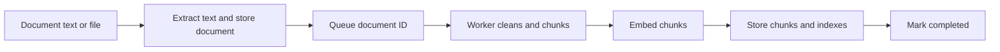
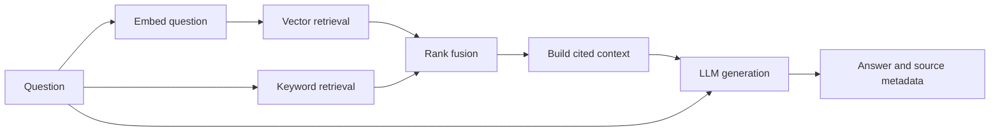

# Learn this RAG project from scratch

This is a practical course through this repository. Work through the stages in order. At each stage, read the named functions, perform the exercise, and answer the checkpoint without looking at the code. Understanding the tradeoffs and measuring your changes matters more than finishing quickly.

The examples describe the current implementation. Exercises marked **extension** are proposed learning work, not features already implemented. Use a separate branch or copy for experiments. Run shell commands from the project root, not from `docs/`.

## Learning route

| Stage | You will learn | Proof of understanding |
| --- | --- | --- |
| 1–3 | Python foundations, environment, RAG vocabulary | Explain and run a small local pipeline |
| 4–6 | Architecture, FastAPI, persistence | Trace a document from HTTP to SQL |
| 7–9 | Parsing, chunking, embeddings, workers | Explain how a document becomes searchable |
| 10–12 | Retrieval, fusion, context, generation | Diagnose where an answer went wrong |
| 13–15 | Testing, evaluation, operations | Measure quality and investigate failures |
| 16–17 | Advanced features and independent rebuild | Build and defend your own RAG design |

## 1. Learn the Python used in this repository

> **Mental model:** Imagine you are learning to cook. Variables hold ingredients, functions are recipes, and modules are recipe books. When a dish needs time in the oven, you prepare something else—`await` similarly lets the event loop handle other work while an asynchronous operation waits.

You do not need to master all of Python before starting. Learn these concepts using small examples, then find them in the application.

| Concept | Meaning | Read it here |
| --- | --- | --- |
| Modules and packages | A `.py` file is a module; packages organize imports | [app entry point](../app/__main__.py), [schema exports](../app/schemas/__init__.py) |
| Functions, classes, `self` | Functions perform work; instances retain dependencies/state | [DocumentsService](../app/services/documents.py) |
| Lists, dictionaries, comprehensions | Collections hold chunks, vectors, and lookup tables | [retrieval helpers](../app/services/retrieval.py) |
| Type hints and `Protocol` | Describe expected values and provider interfaces | [providers](../app/integrations/providers.py) |
| `async def` and `await` | Cooperatively wait for asynchronous work | [QueryService.query](../app/services/retrieval.py) |
| `asyncio.gather` | Run independent asynchronous operations concurrently | [QueryService.query](../app/services/retrieval.py) |
| Context managers and `finally` | Release resources even when an operation fails | [open_resources](../app/resources.py), [worker](../app/workers/ingestion.py) |
| Exceptions | Report failure and decide where recovery belongs | [HTTP handlers](../app/core/exceptions.py) |
| Decorators and `Annotated` | Attach route behavior and dependency metadata | [document routes](../app/api/routes/documents.py) |

An `async` function does not automatically make ordinary blocking work nonblocking. This project uses `asyncio.to_thread` for file parsing and chunking so those operations do not occupy the event-loop thread. That does not imply unlimited CPU parallelism.

**Exercise:** Write a small function that takes a list of document dictionaries and returns only filenames whose status is `completed`. Then write a class that receives that list in its constructor. Finally, write an async function and call it using `asyncio.run`.

**Checkpoint:** Explain the difference between `from app.services.documents import DocumentsService`, constructing `DocumentsService(...)`, and awaiting one of its methods.

## 2. Prepare and verify the environment

> **Mental model:** You arrive at a workshop, but the tools are in another room. Your code cannot work until it uses the room containing its dependencies. The virtual environment is that room; PostgreSQL and Redis are separate machines that also need to be switched on.

Read [pyproject.toml](../pyproject.toml), [requirements.lock](../requirements.lock), [settings](../app/core/config.py), and [docker-compose.yml](../docker-compose.yml).

The project declares Python `>=3.12,<3.15`. The commands below use Python 3.12. If the existing `.venv` is already working, activate it rather than recreating it.

```bash
# Only when creating the environment for the first time:
python3.12 -m venv .venv

source .venv/bin/activate
python -m ensurepip --upgrade
python -m pip install -r requirements.lock -e '.[dev]'
python -m pip check
python -c "import sys; print(sys.executable)"
python -c "from app.main import app; print(app.title)"
python -m pytest -q
```

The lock file pins runtime packages. `-e '.[dev]'` installs this project in editable mode plus its development dependencies. Editable mode lets Python resolve the `app` package while you change its source.

Copy `.env.example` to `.env` only if `.env` does not already exist. Start Docker Desktop, then:

```bash
docker compose up -d postgres redis
python -m app.migrate
python -m app
```

In another terminal:

```bash
source .venv/bin/activate
arq app.worker.WorkerSettings
```

Open `http://localhost:8000/docs`. The default API port is 8000; `python -m app` reads `PORT` if you change it. PostgreSQL and Redis use host ports 55433 and 6380 in this Compose setup.

The API and worker are separate processes. Importing `app.main` is an import smoke check; successful startup additionally requires the resources opened during lifespan. Unit tests mostly replace those resources with test doubles.

**Exercise:** Find your interpreter with the command above and select the same `.venv/bin/python` in VS Code. Explain why installing a package into another Python interpreter does not fix this environment's missing imports.

**Checkpoint:** What are the separate roles of Python, Uvicorn, FastAPI, PostgreSQL, Redis, and the ARQ worker?

## 3. Understand RAG before studying frameworks

> **Mental model:** A customer asks a librarian about a refund policy. The librarian finds the relevant pages and hands them to a colleague, who writes an answer using those pages. Retrieval finds the evidence; generation turns that evidence into an answer.

Retrieval-augmented generation supplies retrieved evidence to a language model when answering a question. Uploading a document here does not train or fine-tune the model.

| Term | Meaning in this project |
| --- | --- |
| Document | An uploaded or submitted source, with identity and processing status |
| Chunk | A smaller searchable portion of its text |
| Token | A tokenizer-defined text unit; not necessarily a word |
| Embedding | A numeric vector representing text for similarity search |
| Retrieval | Selecting candidate chunks for the question |
| Keyword search | Matching indexed words using PostgreSQL full-text search by default |
| Hybrid search | Combining vector and keyword retrieval |
| Context | Retrieved text included with the question in the generation request |
| Citation | A source marker connecting the answer to supplied evidence |
| Grounded answer | An answer supported by the supplied evidence |

There are two separate pipelines:





The second diagram shows data dependencies. In the current code, question embedding finishes before both retrieval calls are started together.

**Exercise:** Use the sentence “Refunds are available within 30 days.” Identify the document, a possible chunk, a question, the evidence, and a supported answer.

**Checkpoint:** Why can an excellent language model still give a poor answer when retrieval misses the relevant chunk?

## 4. Learn the architecture and startup flow

> **Mental model:** Before a restaurant opens, the manager connects the kitchen equipment and assigns each person a role. The waiter takes orders, the cook prepares food, and the storeroom keeps supplies. Startup wires dependencies together; routes, services, and repositories each handle their part of the request.

Read these files in order:

1. [app/__main__.py](../app/__main__.py): starts Uvicorn with `app.main:app`.
2. [app/main.py](../app/main.py): `create_app` registers middleware, exception handlers, routes, and lifespan.
3. [app/core/config.py](../app/core/config.py): `Settings` loads environment configuration and validates it.
4. [app/resources.py](../app/resources.py): `open_resources` opens clients and constructs services.
5. [app/api/dependencies.py](../app/api/dependencies.py): `get_documents` and `get_query` retrieve those service instances.

`resources.py` is the composition point: it decides which embedding provider, LLM provider, and search backend to use. Routes receive services through FastAPI dependency injection instead of constructing clients for every request. `AsyncExitStack` registers cleanup as resources are acquired.

| Layer | Responsibility | Example |
| --- | --- | --- |
| Routes | HTTP inputs and outputs | [query route](../app/api/routes/query.py) |
| Schemas | Validation and response structure | [query schemas](../app/schemas/query.py) |
| Services | Workflow and business behavior | [retrieval service](../app/services/retrieval.py) |
| Repository | SQL and mapping database rows | [repository](../app/db/repository.py) |
| Integrations | Calls to embedding/LLM providers | [providers](../app/integrations/providers.py) |
| Worker | Background execution and retry lifecycle | [ingestion worker](../app/workers/ingestion.py) |
| Core | Cross-cutting configuration and HTTP behavior | [core package](../app/core/__init__.py) |

These are practical boundaries, not perfectly framework-independent layers: `DocumentsService` currently raises FastAPI `HTTPException`, and `SearchService` contains external search HTTP calls.

**Exercise:** Draw the objects created by `open_resources` and arrows for their constructor dependencies.

**Checkpoint:** Where would you change provider selection? Why should that decision not be repeated inside every route?

## 5. Follow an HTTP request and its validation

> **Mental model:** At a parcel counter, the clerk checks that your form has a valid address before accepting the package. They then pass it to the delivery team. Request schemas check the input, and the route passes valid work to a service.

Read [document routes](../app/api/routes/documents.py), [query route](../app/api/routes/query.py), [base schema](../app/schemas/base.py), [document schemas](../app/schemas/documents.py), and [query schemas](../app/schemas/query.py).

For `POST /api/documents`, the handler receives a validated `CreateDocument`, then calls `DocumentsService.create`. For `POST /api/query`, it receives `QueryInput`, then calls `QueryService.query`.

`InputModel` rejects extra fields and trims strings. The JSON document endpoint accepts text in `content`; it does not decode PDF binary data. The upload endpoint handles file bytes. UUID validation applies to document lookup paths. Validation errors are translated to HTTP 400 in [register_exception_handlers](../app/core/exceptions.py).

The route-level `authorize` dependency checks the API key and performs Redis-backed rate limiting. See [dependencies](../app/api/dependencies.py). HTTP middleware handles request IDs, bounded request bodies, and metrics; see [RequestMiddleware](../app/core/middleware.py).

**Exercise:** In `/docs`, submit an empty question, an unexpected JSON field, and an invalid document UUID. Compare the response with a valid request. Use the configured API key when required.

**Checkpoint:** Which layer validates question length? Which layer answers the question? Why is a request model different from a database table?

## 6. Understand storage and run one document end to end

> **Mental model:** A library records a new book in its register before placing it on the shelves. The receipt proves the book was accepted, but readers must wait until shelving finishes. A stored document is accepted first; `completed` means its searchable content is ready.

Read [initial migration](../migrations/001_initial.sql), [migration runner](../app/migrate.py), [Repository.create](../app/db/repository.py), and [DocumentsService.create](../app/services/documents.py).

`documents` stores source identity, raw text, timestamps, and status. `document_chunks` stores chunk text, token counts, embeddings, and a generated full-text search vector. The foreign key links chunks to their document; `(document_id, chunk_index)` is unique.

The migration runner replaces `__DIMENSIONS__` with the configured embedding size. The HNSW index supports cosine vector search, while the GIN index supports full-text search. They serve different retrieval paths.

Run this with the API and worker active. Set the header value to your local `API_KEY`; the example below assumes the README's development key.

```bash
curl -sS -X POST http://localhost:8000/api/documents \
  -H 'Content-Type: application/json' \
  -H 'x-api-key: local-development-key' \
  -d '{"filename":"refund-policy.txt","mimeType":"text/plain","content":"Customers can request refunds within 30 days. A receipt is required."}'
```

Copy the returned ID into the next command:

```bash
curl -sS http://localhost:8000/api/documents/DOCUMENT_ID \
  -H 'x-api-key: local-development-key'
```

The create response is 201 with status `queued`. Poll until `completed`; a 201 response does not mean embeddings already exist. For this creation path, normal processing is `queued → processing → completed`, with `failed` on processing errors. The schema also allows `uploaded`, but this path inserts `queued` directly.

**Exercise:** Inspect the rows without modifying them:

```bash
docker compose exec postgres psql -U postgres -d rag_fastapi -c \
  "SELECT filename, status FROM documents ORDER BY created_at DESC LIMIT 5;"

docker compose exec postgres psql -U postgres -d rag_fastapi -c \
  "SELECT document_id, chunk_index, token_count FROM document_chunks LIMIT 10;"
```

**Checkpoint:** Why persist the document before enqueueing its ID? Why do repository queries use `$1`, `$2` parameters?

## 7. Study extraction, cleaning, and chunking

> **Mental model:** You copy a long handbook onto study cards. Each card needs enough information to make sense, and you repeat a little context when a topic continues onto the next card. Extraction reads the handbook, cleaning tidies it, and chunking makes those overlapping cards.

Read [extract_file, clean_text, chunk_text](../app/services/ingestion.py) and [DocumentsService.upload](../app/services/documents.py).

File extraction happens in the API upload workflow, before the document is stored. Cleaning and chunking happen in the worker. PDF extraction reads text already present in the PDF; this project does not implement OCR for scanned pages.

`chunk_text` uses LlamaIndex's `SentenceSplitter`, with defaults of 200 tokens and 30-token overlap. Overlap carries nearby context across boundaries. Smaller chunks can isolate facts but lose context; larger chunks can preserve context but include unrelated material. Measure the tradeoff on your own documents.

Try this without PostgreSQL or Redis:

```bash
python - <<'PY'
from app.services.ingestion import clean_text, chunk_text

text = "Refunds are available within 30 days. A receipt is required. " * 30
for size, overlap in [(40, 5), (100, 15), (200, 30)]:
    chunks = chunk_text(clean_text(text), size=size, overlap=overlap)
    print(size, overlap, len(chunks), [c['token_count'] for c in chunks])
    print(chunks[0]['content'])
PY
```

**Exercise:** Repeat with headings, a table, and a sentence containing an exception to a rule. Look for boundaries that separate a rule from its exception. Read `test_chunking_and_cleaning`, `test_text_uploads`, and `test_office_uploads` in [pipeline tests](../tests/test_pipeline.py).

**Checkpoint:** Why is a fixed number of characters different from a fixed number of tokens? What information is lost when a PDF becomes plain text?

## 8. Understand embeddings and provider contracts

> **Mental model:** Imagine placing study cards on a map so cards about similar ideas sit near one another. A semantic embedding model supplies their coordinates, and a question gets coordinates on the same map. The fake provider only supplies practice coordinates; it does not understand which ideas belong together.

Read `EmbeddingProvider`, `LlmProvider`, `FakeEmbeddingProvider`, `OpenAICompatibleProvider`, and `validate_vector` in [providers](../app/integrations/providers.py).

An embedding model maps text into a vector. Semantic retrieval depends on using compatible embeddings for documents and questions. Matching dimensions alone is insufficient: changing the embedding model requires re-embedding the stored content.

The fake embedding implementation distributes UTF-16 character values into numeric buckets and normalizes the result. It is useful for deterministic plumbing tests, but it does not demonstrate semantic embedding quality. `FakeLlmProvider` returns a placeholder or an insufficient-context message; it does not synthesize a factual answer from your documents.

For nonzero vectors, cosine similarity is:

```text
similarity(a, b) = dot(a, b) / (length(a) * length(b))
cosine_distance = 1 - cosine_similarity
```

The real provider implementation calls an OpenAI-compatible HTTP interface. This is an interface contract, not proof that every provider supports every parameter. The embedding request includes `dimensions`; verify support for the endpoint/model you choose.

**Exercise:** Read `test_remote_provider_contract` and `test_remote_rejects_invalid_vectors` in [pipeline tests](../tests/test_pipeline.py). Explain how mocked HTTP responses test request shape and validation without calling a paid service.

**Checkpoint:** Why are fake-provider tests not evidence that semantic retrieval works well? Where are vector length and finite numeric values checked?

## 9. Understand workers, retries, and consistency

> **Mental model:** A bakery gives you an order number while a baker works in the back. If a batch fails, the baker may try again; a completed order should not be baked twice just because its ticket reappears. The queue carries work, and the worker manages processing, retries, and duplicate handling.

Read [worker entry point](../app/worker.py), then `WorkerSettings`, `startup`, `dispatch_queued`, and `process_document` in [worker implementation](../app/workers/ingestion.py).

The worker performs these operations:

1. Acquire a PostgreSQL connection and a document-specific advisory lock.
2. Read the document; return if it is missing or already completed.
3. Mark it `processing`, clean text, and create chunks.
4. Embed each chunk sequentially.
5. Replace its chunk rows inside a database transaction.
6. Synchronize external indexes when enabled.
7. Mark it `completed` and release the lock.

On ordinary processing errors, it marks the document `failed` and requests a retry if attempts remain. Configuration allows three attempts. A transient `failed` status can therefore occur before a later successful retry. Completed documents are skipped on duplicate execution.

`dispatch_queued` runs at startup and at seconds 0 and 30 of each minute. It recovers durable `queued` rows that were not successfully dispatched. This is not a universal recovery mechanism for every stuck state; the dispatcher does not scan all `processing` or `failed` rows.

**Exercise:** In your local development setup, stop only the worker, create a document, observe `queued`, then restart the worker and observe completion. Read [worker tests](../tests/test_worker.py) to inspect simulated provider failures.

**Checkpoint:** What does the transaction protect? What does the advisory lock protect? Why are PostgreSQL writes and external index updates not one atomic transaction?

## 10. Learn vector, keyword, and hybrid retrieval

> **Mental model:** You ask two librarians for help: one looks for similar meanings, while the other looks for the words you used. Each gives you a ranked reading list. Hybrid retrieval combines those lists, and rank fusion rewards passages recommended highly by both.

Read `SearchService.vector_search` and `keyword_search` in [search](../app/services/search.py), then the corresponding repository methods in [repository](../app/db/repository.py).

The default backend uses PostgreSQL for both searches:

- Vector retrieval orders by pgvector cosine distance (`<=>`). Lower distance is better.
- Keyword retrieval uses `websearch_to_tsquery('english', ...)` and `ts_rank_cd`. Higher rank is better. This is PostgreSQL full-text ranking, not an implementation of BM25 in this code.
- Both paths filter for completed documents and retrieve up to 10 results by default.

Keyword matching can help with exact terms; semantic embeddings can help with paraphrases. The current English text-search configuration is a deliberate point to revisit for Bangla or multilingual documents.

In [merge_hybrid_results](../app/services/retrieval.py), reciprocal-rank fusion combines ranks rather than adding incompatible raw scores:

```text
contribution = 1 / (60 + rank), where rank starts at 1

Chunk A: vector rank 1 only       → 1/61        ≈ 0.01639
Chunk B: vector rank 2, keyword 1 → 1/62 + 1/61 ≈ 0.03252
```

Chunk B wins because both retrieval paths support it. Results are merged by `(documentId, chunkIndex)`, sorted by fused score, and limited to five.

**Exercise:** Work out a three-chunk example on paper, then compare with `test_rrf_merges_and_ranks_shared_results` in [pipeline tests](../tests/test_pipeline.py).

**Checkpoint:** Why would adding raw cosine distances and keyword ranks produce misleading results? Is rank fusion the same as a learned reranker? (No: this code does not implement a learned reranker.)

## 11. Build context and generate an answer

> **Mental model:** Before writing a report, you collect a few useful excerpts and label them “source 1” and “source 2.” You hand that evidence sheet to a writer along with the question. Context building prepares the sheet; generation writes the response, which still needs checking against the evidence.

Read [build_context and QueryService.query](../app/services/retrieval.py), [query response schemas](../app/schemas/query.py), and `OpenAICompatibleProvider.generate` in [providers](../app/integrations/providers.py).

`build_context` adds `[source:1]` markers and source metadata. It uses an approximate 3,000-character budget, not a token budget. The first chunk is always included even if it exceeds the budget; separator characters are not counted. The test `test_context_preserves_first_chunk_and_citations` explicitly captures this behavior.

The real generation prompt asks the model to use supplied context, cite sources, and treat retrieved content as data. The response includes `answer`, `sources`, and debug information. Source metadata describes supplied evidence; the application does not automatically verify every factual claim or citation in the generated answer.

```bash
curl -sS -X POST http://localhost:8000/api/query \
  -H 'Content-Type: application/json' \
  -H 'x-api-key: local-development-key' \
  -d '{"question":"What do I need to get a refund?"}'
```

**Exercise:** Inspect `debug.results`, then `debug.context`, then `answer`, in that order. With fake providers, expect a placeholder answer. Ask a question unrelated to your documents: vector search can still return nearest neighbors, so this system does not guarantee an empty context or abstention for unrelated questions.

**Checkpoint:** Did the relevant evidence reach the model? Does the answer actually follow from that evidence? Why is a source marker not proof of factual correctness?

## 12. Move to real providers deliberately

> **Mental model:** During a rehearsal, an actor answers a disconnected telephone using a script. On opening night, the telephone connects to a real person, with real delays and unexpected replies. Switching from fake to real providers similarly introduces actual model behavior, network failures, and usage costs.

Read [Settings.validate_providers](../app/core/config.py), [resource construction](../app/resources.py), and [provider requests](../app/integrations/providers.py).

First use fake providers to understand the mechanics. When ready for semantic-quality experiments, configure a compatible service using these `.env` fields:

```dotenv
EMBEDDING_PROVIDER=openai-compatible
LLM_PROVIDER=openai-compatible
OPENAI_COMPATIBLE_BASE_URL=https://your-provider.example/v1
OPENAI_COMPATIBLE_API_KEY=your-local-secret
EMBEDDING_MODEL=your-supported-embedding-model
EMBEDDING_DIMENSIONS=1536
LLM_MODEL=your-supported-generation-model
```

These are placeholders, not a working provider configuration. The dimension value must match your selected model and database schema. Both providers currently share a base URL and API key. Supporting separate services would require a configuration/wiring extension.

Use a separate development database and matching external index names for incompatible embedding experiments. The migration runner detects dimension mismatches; it does not automatically convert stored embeddings. Restart API and worker after configuration changes, and reingest documents when changing the embedding model. `app.reindex` copies existing embeddings to external indexes; it does not create new embeddings.

**Exercise:** Compare an exact-term question and a paraphrased question with the same known answer. Record retrieved chunks before judging the generated answer.

**Checkpoint:** Why is switching models while retaining old vectors unsafe even when the new model has the same vector length?

## 13. Use tests as executable lessons

> **Mental model:** Before opening a café, you check the kettle alone, then rehearse an order using a pretend customer, then serve a real order through the whole kitchen. Unit, API, and integration tests check different scopes. Passing the kettle check does not prove the entire café works.

| File | What to study | What it does not prove |
| --- | --- | --- |
| [test_pipeline.py](../tests/test_pipeline.py) | Extraction, chunking, fusion, context, validation, provider contracts | Real model quality or live service compatibility |
| [test_api.py](../tests/test_api.py) | HTTP contract, auth, uploads, limits, readiness failures | Live PostgreSQL and Redis behavior |
| [test_worker.py](../tests/test_worker.py) | Failure status, retry behavior, lock-release call | Real concurrent PostgreSQL lock behavior |
| [test_integration.py](../tests/test_integration.py) | Database, queue, worker, retrieval, duplicate handling | Comprehensive concurrency, load, or production reliability |

```bash
python -m pytest -q
python -m pytest tests/test_pipeline.py -q
python -m pytest tests/test_api.py -q
python -m ruff check app tests
python -m ruff format --check app tests

# Requires running services and migrations on the dedicated development/test DB:
RUN_INTEGRATION=1 python -m pytest -q -m integration
```

Do not point the integration test at a production database. It creates and removes test records. The integration test is skipped unless explicitly enabled; a passing default suite is not a full live-system check.

**Exercise:** Choose a test, predict its result, then temporarily break the corresponding behavior in an experimental branch. Confirm that the test fails for the reason you expected and restore the code.

**Checkpoint:** How do mocks help isolate behavior, and which failures can they hide?

## 14. Evaluate RAG quality systematically

> **Mental model:** A teacher prepares an answer key before grading the class. Without that key, a confident answer might look correct even when it misses the question. A labeled evaluation set gives you a consistent way to judge whether retrieval found the evidence and generation used it correctly.

This repository does not yet include a labeled RAG evaluation harness. Build one as an **extension**, using [QueryService](../app/services/retrieval.py) and its debug output as observation points.

Create a small corpus and at least 20 questions covering exact facts, paraphrases, ambiguous questions, conflicting sources, and questions the corpus cannot answer. Label the relevant documents/chunks and required answer facts before tuning the pipeline.

A useful case shape is:

```json
{
  "question": "How long do customers have to request a refund?",
  "relevant_sources": ["refund-policy.txt"],
  "required_facts": ["30 days"],
  "answerable": true
}
```

Use document-plus-chunk labels when measuring chunk retrieval. Source filenames alone are only document-level labels; avoid treating those metrics as equivalent.

| Measure | How to calculate or inspect it |
| --- | --- |
| Recall@k | Relevant items in top k divided by all labeled relevant items |
| Precision@k | Relevant items in top k divided by k, for a fixed-k evaluation |
| Reciprocal rank | `1 / rank` of the first relevant hit; zero if none is found |
| Answer support | Check each factual claim against the provided evidence |
| Citation correctness | Check whether the cited chunk supports the linked claim |
| Abstention behavior | On unanswerable cases, check whether unsupported answers are avoided |
| Latency and cost | Record retrieval/generation times and provider token usage where available |

Average reciprocal rank across questions to obtain MRR. Keep unanswerable cases separate from recall calculations that would have a zero denominator. Define how fewer-than-k results are scored and keep that policy consistent.

**Exercise:** Establish a baseline, then change only one variable: chunk size, overlap, retrieval candidate count, fusion limit, or context budget. Reingest when chunking changes. Record configuration, model, corpus version, quality, and latency. Keep a held-out question set so repeated tuning does not simply memorize your examples.

**Checkpoint:** Can you show an improvement with measurements and explain its cost? If the answer is wrong, is the failure in extraction, retrieval, context selection, or generation?

## 15. Learn operations and diagnose failures

> **Mental model:** A shop has its lights on, but its delivery van has stopped working. Seeing an open storefront does not tell you whether orders are being delivered. Liveness, readiness, worker status, and logs reveal different parts of your RAG system’s condition.

Read [health routes](../app/api/routes/health.py), [middleware](../app/core/middleware.py), [telemetry](../app/core/telemetry.py), [Compose](../docker-compose.yml), and [Dockerfile](../Dockerfile).

Liveness reports that the API is responding. Readiness probes configured data/search dependencies. Neither proves that an ARQ worker is actively consuming jobs. Request IDs connect HTTP activity to logs; RAG spans separate embedding, retrieval, generation, ingestion, and indexing work.

| Symptom | First places to inspect |
| --- | --- |
| Import error | Interpreter path, installed dependencies, package launch command |
| Startup connection failure | Docker/service state, `Settings`, `open_resources` |
| Document remains queued | Worker process, queue name, `dispatch_queued` |
| Document fails processing | Worker exception log, parsing/chunking, provider response |
| Query has weak results | Completed status, stored chunks, embedding compatibility, retrieval output |
| Results are good but answer is wrong | `debug.context`, prompt, generation provider |
| HTTP 401 / 429 | API key / Redis rate-limit behavior in `authorize` |
| HTTP 400 / 413 on upload | Service file-size validation / middleware body limit |

**Exercise:** Stop and restart your local worker and observe document status. Separately stop Redis in a disposable local setup and inspect readiness and request failures, then restore it. Do not assume every queue outage still permits document creation: authorization itself uses Redis before the handler can run. The queue-enqueue failure test isolates a narrower failure after authorization succeeds.

**Checkpoint:** What would you monitor to detect an accumulating queue, stuck processing, increased provider latency, and poor answer quality? Which of these is not visible in the existing HTTP metrics?

## 16. Extend the design after measuring the baseline

> **Mental model:** A café owner notices customers waiting at the payment counter. Buying a faster oven would not fix that queue. Measure your RAG system first, then add the feature that addresses the observed weakness—such as better context selection, reranking, or recovery.

These are learning projects, not claims about existing capabilities. Complete one at a time with a test and an evaluation result.

| Extension | Start here | Acceptance criterion |
| --- | --- | --- |
| Token-budgeted context | [build_context](../app/services/retrieval.py) | Context fits a specified tokenizer budget, including markers and separators |
| Metadata-aware chunks | [ingestion](../app/services/ingestion.py), [schema](../migrations/001_initial.sql), [repository](../app/db/repository.py) | Section/page identity survives storage, retrieval, and citations |
| Reranking | [QueryService](../app/services/retrieval.py) | Rerank retrieved candidates and compare held-out quality/latency |
| Answerability handling | [retrieval](../app/services/retrieval.py), [providers](../app/integrations/providers.py) | Improve unanswerable-case results without discarding useful evidence |
| Batched embedding | [worker](../app/workers/ingestion.py), [providers](../app/integrations/providers.py) | Preserve input/output mapping and handle partial failures and rate limits |
| Tenant-scoped retrieval | [dependencies](../app/api/dependencies.py), [repository](../app/db/repository.py), [search](../app/services/search.py) | Unauthorized documents never enter retrieved context, including external-search paths |
| Document versioning | [documents service](../app/services/documents.py), [worker](../app/workers/ingestion.py) | Updates expose one intended version and retire stale chunks/index entries |
| Recovery for stuck work | [worker](../app/workers/ingestion.py) | Define ownership/timeouts and test crash recovery without duplicate corruption |

The shared API key is not a per-user document authorization system. Prompt instructions also do not enforce document access control. Those concerns must be handled before evidence reaches generation.

Study the optional external backend only after understanding the PostgreSQL path. Read `ensure_indexes`, `sync_document`, and retrieval methods in [SearchService](../app/services/search.py), `Repository.hydrate` in [repository](../app/db/repository.py), and [reindex](../app/reindex.py).

External hits are hydrated against current PostgreSQL rows and completed documents. This prevents returning missing or stale chunk IDs, but the external stores are still separate systems requiring synchronization. Follow the [README external-search instructions](../README.md#optional-external-search) when running that experiment.

## 17. Rebuild a small RAG system independently

> **Mental model:** After following a cooking lesson, you make the dish again without the recipe beside you. When something tastes wrong, you work out which step caused it. Rebuilding a small RAG system independently turns recognition of this code into the ability to design and debug your own.

Use a separate learning project. Recreate the following milestones without copying entire modules:

1. Read plain text, split it into chunks, and print those chunks.
2. Add deterministic test embeddings and a simple in-memory retrieval function.
3. Define provider interfaces and replace test embeddings with a compatible semantic model.
4. Retrieve evidence for a question and display it without generation.
5. Build source-marked context and add an answer-generation provider.
6. Add typed HTTP endpoints and input validation.
7. Persist documents and chunks in PostgreSQL.
8. Add background ingestion, observable status, and retry behavior.
9. Add keyword retrieval and compare it with vector-only and hybrid retrieval.
10. Build a labeled evaluation set and record quality, latency, and cost.
11. Add failure tests, resource cleanup, readiness, and operational diagnostics.
12. Choose one advanced feature based on a measured weakness.

For each milestone, explain what it adds, how you tested it, and what failure remains possible. Compare your implementation with the corresponding files here only after your first attempt.

## Final self-assessment

You are ready to design your own RAG backend when you can do these without following a recipe:

- Trace one uploaded file through parsing, storage, queueing, chunking, embedding, and indexing.
- Trace one question through embedding, both retrieval paths, fusion, context, and generation.
- Explain why the same question gets poor results and identify the failing stage using evidence.
- Choose chunking and retrieval settings through measured experiments.
- Distinguish a passing plumbing test from evidence of semantic quality or live-system reliability.
- Change models without mixing incompatible vectors.
- Design recovery for retries and crashes, and explain the limits of the current implementation.
- Produce an evaluation report that another developer can reproduce.

Keep a learning log with four entries per stage: what you predicted, what you ran, what happened, and what you still cannot explain. Revisit those unanswered questions before adding another framework or backend.
